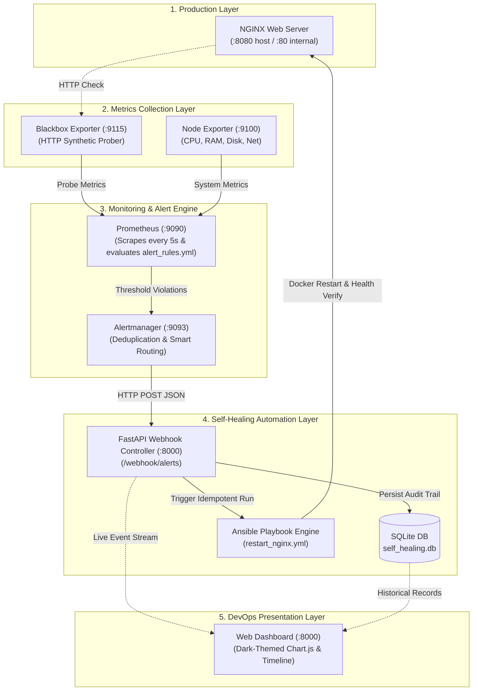

# 🛡️ Self-Healing Infrastructure with Prometheus, Alertmanager & Ansible

[](https://github.com/)
[](https://prometheus.io/)
[](https://prometheus.io/docs/alerting/latest/alertmanager/)
[](https://www.ansible.com/)
[](https://fastapi.tiangolo.com/)
[](https://docs.docker.com/compose/)
[](LICENSE)

An enterprise-grade, beginner-friendly **Autonomous Self-Healing Infrastructure** control plane designed for computer science students and DevOps engineers. This system detects server and service outages in real-time, alerts on critical state deviations, and automatically triggers idempotent **Ansible automation** to restore services to a healthy state without manual intervention.

---

## 📑 Table of Contents

1. [Project Overview](#-project-overview)
2. [End-to-End System Architecture](#-end-to-end-system-architecture)
3. [Technology Stack](#-technology-stack)
4. [Project Directory Structure](#-project-directory-structure)
5. [How Automated Recovery Works](#-how-automated-recovery-works)
6. [Prerequisites & Quick Setup](#-prerequisites--quick-setup)
7. [Starting and Stopping the Stack](#-starting-and-stopping-the-stack)
8. [Dashboard & Service Access Matrix](#-dashboard--service-access-matrix)
9. [Hands-On Failure Simulation Guide (Evaluation Tests)](#-hands-on-failure-simulation-guide-evaluation-tests)
10. [Configuration Deep Dive (What Each File Does)](#-configuration-deep-dive-what-each-file-does)
11. [Troubleshooting Guide](#-troubleshooting-guide)
12. [Interview & Internship Evaluation Guide](#-interview--internship-evaluation-guide)

---

## 🎯 Project Overview

Traditional infrastructure operations rely on human engineers receiving on-call alerts, manually logging into servers, diagnosing failures, and executing remediation commands. This creates downtime, increases MTTR (Mean Time to Resolution), and introduces human error.

### The Objective

This project builds an automated closed-loop remediation pipeline:
1. **NGINX Web Server** serves live traffic.
2. **Blackbox Exporter** continuously probes website endpoints via HTTP GET.
3. **Node Exporter** gathers host CPU, RAM, and Disk telemetry.
4. **Prometheus** aggregates metrics and evaluates alert expressions every 5 seconds.
5. **Alertmanager** routes and deduplicates failure alerts.
6. **FastAPI Webhook Receiver** receives Alertmanager payloads, debounces duplicate requests, and dispatches Ansible playbooks.
7. **Ansible Playbook (`restart_nginx.yml`)** idempotently checks container state, restarts NGINX, validates runtime health, and returns structured execution logs.
8. **Interactive Control Dashboard** provides real-time Chart.js visual metrics, active alert tables, SQLite persistent recovery logs, and a chronological activity timeline.

---

## 🏗️ End-to-End System Architecture



---

## 🧰 Technology Stack

| Layer | Technology | Purpose |
|---|---|---|
| **Web Server** | NGINX Alpine | Target production service delivering web traffic |
| **System Telemetry** | Prometheus Node Exporter | Collects CPU, memory, filesystem, and network counters |
| **Synthetic Monitoring** | Prometheus Blackbox Exporter | Performs black-box HTTP probing against the web server |
| **Metrics Database** | Prometheus v2.54.1 | Time-series database scraping targets and evaluating rules |
| **Alert Routing** | Alertmanager v0.27.0 | Groups, silences, and routes notifications via HTTP webhooks |
| **Remediation Engine** | Ansible Core | Declarative, idempotent configuration and container orchestrator |
| **Control Plane API** | Python 3.11 + FastAPI | Webhook receiver, validation, debouncing, and REST API |
| **Persistent Storage** | SQLite 3 | Embedded database storing alert history and Ansible execution logs |
| **Frontend UI** | HTML5 / CSS3 / JavaScript | Responsive dark-navy interface with Chart.js visualization |
| **Orchestration** | Docker & Docker Compose | Containerized reproducible environment for Windows/Linux |

---

## 📁 Project Directory Structure

```text
elevatelab/
│
├── backend/                        # FastAPI Control Plane & Webhook Receiver
│   ├── main.py                     # App entry point, REST endpoints & static server
│   ├── webhook.py                  # Alertmanager webhook processor & Ansible dispatcher
│   ├── monitoring.py               # Prometheus metrics query client & psutil fallback
│   ├── database.py                 # SQLite database operations & table schemas
│   ├── models.py                   # Pydantic schema validation models
│   └── requirements.txt            # Python dependencies
│
├── frontend/                       # Interactive Monitoring & Control UI
│   ├── index.html                  # Responsive dark-navy dashboard structure
│   ├── style.css                   # Custom styles, glassmorphism cards & timeline
│   └── script.js                   # Chart.js controller, auto-polling & simulation API
│
├── prometheus/                     # Prometheus Configuration
│   ├── prometheus.yml              # Scrape configs for Blackbox, Node Exporter & Self
│   └── alert_rules.yml             # NGINXDown, HighCPUUsage & HighMemoryUsage rules
│
├── alertmanager/                   # Alertmanager Configuration
│   └── alertmanager.yml            # Webhook routing & grouping rules
│
├── blackbox/                       # Synthetic Prober Configuration
│   └── blackbox.yml                # HTTP 2xx prober module definition
│
├── ansible/                        # Automated Remediation Engine
│   ├── restart_nginx.yml           # Idempotent recovery & health verification playbook
│   ├── inventory.ini               # Local inventory definition
│   └── ansible.cfg                 # Ansible runtime settings
│
├── nginx/                          # Monitored Web Server
│   └── index.html                  # Production landing page
│
├── tests/                          # Automated Integration Test Suite
│   └── test_workflow.py            # End-to-end Python test cases
│
├── database/                       # Persistent SQLite database storage
├── logs/                           # Execution logs storage
├── docker-compose.yml              # 6-service unified Docker topology
├── Dockerfile                      # Backend container with Python + Ansible + Docker CLI
├── run.ps1                         # Windows PowerShell startup helper script
├── run.sh                          # Linux / macOS Bash startup script
├── .env.example                    # Template environment variables
├── .gitignore                      # Git exclusion rules
└── README.md                       # Comprehensive documentation
```

---

## 🔄 How Automated Recovery Works

1. **Failure Occurs**: The NGINX web server crashes or is manually stopped.
2. **Detection**: Blackbox Exporter probes `http://nginx:80` and fails (`probe_success == 0`).
3. **Alert Triggered**: Prometheus detects `probe_success == 0` for 5 seconds and generates the critical alert `NGINXDown`.
4. **Alert Routing**: Alertmanager receives `NGINXDown`, groups it, and dispatches a JSON payload to `http://backend:8000/webhook/alerts`.
5. **Debouncing & Audit**: FastAPI validates the payload:
   - Verifies alert status (`firing`).
   - Checks if a recovery for `nginx` is already in progress within 30 seconds (prevents execution flaps).
   - Generates a unique tracking event ID (e.g. `REC-90CB96FA`).
   - Inserts a record in SQLite with status `RECOVERY STARTED`.
6. **Ansible Remediation**:
   - Executes `ansible-playbook -i ansible/inventory.ini ansible/restart_nginx.yml`.
   - The playbook checks container state, restarts the container, verifies it is running, and probes `http://nginx:80` for `HTTP 200 OK`.
7. **Confirmation & Visualization**:
   - Webhook updates the SQLite record to `RECOVERED` with full stdout logs.
   - The web dashboard updates live (within 5 seconds) to show green health, recovery count incremented, and detailed logs.

---

## 🚀 Prerequisites & Quick Setup

### Prerequisites
- **Operating System**: Windows 10/11 with Docker Desktop, or Linux (Ubuntu 20.04/22.04), or macOS.
- **Tools**:
  - [Docker Desktop](https://www.docker.com/products/docker-desktop/) (recommended for full containerized cluster).
  - Python 3.10+ (if running tests or local standalone demo mode).
  - Git.

### Quick Clone & Setup
```bash
git clone <your-repository-url>
cd elevatelab
```

---

## 💻 Starting and Stopping the Stack

### Method A: Docker Compose (Complete Stack - Recommended)

1. Ensure **Docker Desktop** is running on your laptop.
2. Start all 6 services:
   ```bash
   docker compose up -d --build
   ```
3. Verify running containers:
   ```bash
   docker compose ps
   ```
4. Stop all services when finished:
   ```bash
   docker compose down
   ```

### Method B: One-Click Startup Script

- **Windows (PowerShell)**:
  ```powershell
  .\run.ps1
  ```
- **Linux / Ubuntu (Bash)**:
  ```bash
  chmod +x run.sh
  ./run.sh
  ```

### Method C: Local Standalone Python Mode (Zero Docker Dependency)

If Docker Desktop is not started, run the control plane directly in Python:
```powershell
.\run.ps1 -LocalStandalone
# Or manually:
python -m pip install -r backend/requirements.txt
python backend/main.py
```

---

## 🌐 Dashboard & Service Access Matrix

Once running, access the following interfaces in your browser:

| Service | URL | Default Port | Description |
|---|---|---|---|
| **Self-Healing Dashboard** | [http://localhost:8000](http://localhost:8000) | `8000` | Main DevOps monitoring & control plane |
| **NGINX Web Application** | [http://localhost:8080](http://localhost:8080) | `8080` | Monitored target production website |
| **Prometheus Web UI** | [http://localhost:9090](http://localhost:9090) | `9090` | Metrics queries, targets, and alert rules |
| **Alertmanager Web UI** | [http://localhost:9093](http://localhost:9093) | `9093` | Alert grouping, routing, and silences |
| **Node Exporter** | [http://localhost:9100/metrics](http://localhost:9100/metrics) | `9100` | Raw system counters and hardware metrics |
| **Blackbox Exporter** | [http://localhost:9115](http://localhost:9115) | `9115` | Synthetic HTTP prober endpoint |

---

## 🧪 Hands-On Failure Simulation Guide (Evaluation Tests)

Follow these 4 tests during your evaluation to demonstrate full self-healing capability.

### Test 1: Normal Operation Verification
1. Start the stack and open [http://localhost:8000](http://localhost:8000).
2. Verify:
   - System Status displays `ONLINE`.
   - NGINX Service displays `RUNNING` (HTTP 200 OK).
   - CPU and Memory line charts update smoothly every 5 seconds.
   - Website Availability shows `100% UP`.
   - Total alerts shows `0 ACTIVE`.

---

### Test 2: NGINX Failure & Automated Recovery
1. Open your terminal or click the red **"Kill / Stop NGINX"** button on the dashboard.
   ```bash
   docker stop nginx
   ```
2. **Watch the live sequence on the dashboard**:
   - Within 5 seconds, Blackbox probe fails (`HTTP status: DOWN`).
   - Dashboard status pill transitions to red **`INCIDENT IN PROGRESS`**.
   - Prometheus fires alert `NGINXDown`.
   - Alertmanager sends webhook to FastAPI.
   - Activity Timeline adds: `Automated Recovery Triggered [REC-XXXX]`.
   - Ansible playbook `restart_nginx.yml` executes:
     - Checks container state (`exited`).
     - Restarts container (`docker start nginx`).
     - Verifies runtime state (`running`).
     - Probes `http://nginx:80` (`HTTP 200 OK`).
   - Status updates to green **`RECOVERED`**.
   - Succeeded Recovery count increments by `+1`.
   - Click **"View Logs"** in the Recovery History table to inspect the Ansible execution output!

---

### Test 3: High CPU Threshold Alert (Notification Only)
1. Click the orange **"Simulate High CPU (>90%)"** button on the dashboard, or run:
   ```bash
   curl -X POST http://localhost:8000/api/simulate/cpu-load?duration=15
   ```
2. **Observe**:
   - The CPU utilization line chart spikes on the dashboard.
   - An orange warning notification is logged in the Activity Timeline:
     `Resource Warning: HighCPUUsage (No service restart required for resource warnings)`.
   - **Crucial Check**: NGINX is **NOT** restarted because CPU spikes are resource warnings, not service outages.

---

### Test 4: Simulating Recovery Failure Handling
1. Temporarily prevent Ansible from reaching Docker (e.g. rename container or stop daemon):
   ```bash
   docker rename nginx nginx_corrupted
   ```
2. Trigger recovery via the dashboard or webhook.
3. **Observe**:
   - Ansible attempts recovery and reports error.
   - Backend records status as **`RECOVERY FAILED`** in red.
   - The exact failure reason and container error are captured in SQLite and viewable via the **"View Logs"** modal on the dashboard.
4. Restore standard state:
   ```bash
   docker rename nginx_corrupted nginx
   ```

---

## 🔍 Configuration Deep Dive (What Each File Does)

### 1. `prometheus/prometheus.yml`
Configures Prometheus to scrape `node-exporter:9100`, `blackbox-exporter:9115` (probing `http://nginx:80`), and itself. Sets `scrape_interval: 5s` and `evaluation_interval: 5s` to enable fast demonstration response times.

### 2. `prometheus/alert_rules.yml`
Defines standard PromQL alert expressions:
- `NGINXDown`: `probe_success{job="blackbox-http"} == 0` for 5s (Severity: critical).
- `HighCPUUsage`: `(100 - (avg by (instance) (rate(node_cpu_seconds_total{mode="idle"}[1m])) * 100)) > 90` for 30s (Severity: warning).
- `HighMemoryUsage`: Host memory capacity above 90% (Severity: warning).

### 3. `alertmanager/alertmanager.yml`
Configures Alertmanager routing rules. Routes critical NGINX service alerts and system warning alerts to the FastAPI webhook receiver at `http://backend:8000/webhook/alerts`.

### 4. `ansible/restart_nginx.yml`
The core self-healing playbook. Uses declarative Ansible tasks:
1. Records timestamp.
2. Inspects NGINX container state.
3. Restarts container if stopped or exited.
4. Verifies container is running.
5. Executes HTTP URI health probe on port 80.
6. Fails if health check fails; outputs structured JSON summary on success.

### 5. `backend/webhook.py`
Processes incoming JSON alerts from Alertmanager. Implements debouncing (prevents duplicate runs within 30 seconds), dispatches Ansible as a subprocess, records execution output, and persists status to SQLite.

### 6. `backend/monitoring.py`
Queries Prometheus HTTP API for instant metrics. Automatically falls back to live Python `psutil` counters if Prometheus is still initializing, guaranteeing uninterrupted dashboard rendering.

### 7. `backend/database.py`
Manages the persistent SQLite database (`database/self_healing.db`). Stores all alert events, recovery history, and timeline entries across container restarts.

---

## 🔧 Troubleshooting Guide

| Issue | Cause | Solution |
|---|---|---|
| **`docker ps` fails on Windows** | Docker Desktop engine is not running | Launch Docker Desktop from the Start menu and wait until the whale icon is solid green. |
| **Port conflict on 8080 or 8000** | Another application (e.g. Jenkins, Tomcat) is using the port | Change `HOST_PORT_DASHBOARD` or `HOST_PORT_NGINX` in `.env` or `docker-compose.yml`. |
| **Ansible playbook permission error on `/var/run/docker.sock`** | User permissions inside container | Docker socket permissions are handled automatically in the Dockerfile; ensure Docker Desktop has WSL integration enabled. |
| **Charts show static or 0% values** | Node Exporter is still scraping | Wait 10 seconds for Prometheus to collect initial rate samples. The dashboard auto-refreshes every 5 seconds. |

---

## 🎓 Interview & Internship Evaluation Guide

### Key Questions You Can Confidently Answer

#### Q1: "Why did you use Alertmanager instead of having Prometheus directly execute Ansible?"
> **Answer**: *"Prometheus is purely a time-series metric aggregation and rule evaluation engine. It follows the Unix philosophy of doing one thing well. Alertmanager is required for deduplication, alert grouping, rate-limiting, and silence handling. By routing alerts through a dedicated webhook receiver, we prevent alert storms from repeatedly hammering the remediation system."*

#### Q2: "How does your system prevent flapping or duplicate recovery runs?"
> **Answer**: *"In `backend/webhook.py`, we implement an idempotency check and debouncing mechanism. When an alert arrives, the system queries SQLite to see if a recovery action for `nginx` was initiated within the last 30 seconds. If an active recovery is in progress, duplicate triggers are skipped."*

#### Q3: "What is the difference between Node Exporter and Blackbox Exporter?"
> **Answer**: *"Node Exporter provides internal white-box metrics (CPU utilization, RAM consumption, disk I/O). Blackbox Exporter provides external black-box synthetic monitoring (HTTP status codes, DNS resolution latency, SSL expiry). Even if an NGINX container is running at 10% CPU, it could be returning 502 Bad Gateway errors; Blackbox Exporter catches real end-user service failures immediately."*

#### Q4: "Why did you use Ansible for recovery instead of a simple bash script?"
> **Answer**: *"Ansible is declarative, idempotent, and auditable. Unlike a shell script that blindly executes commands, the Ansible playbook checks existing container state, verifies execution status, performs post-recovery health probes, and returns machine-readable execution logs that are audited in our SQLite database."*

---

## 📜 License

This project is licensed under the MIT License - open-source and free for educational and commercial use.
